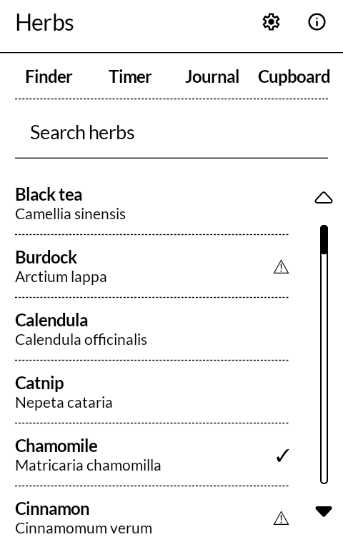
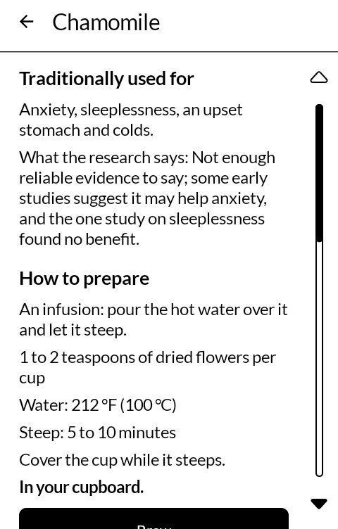
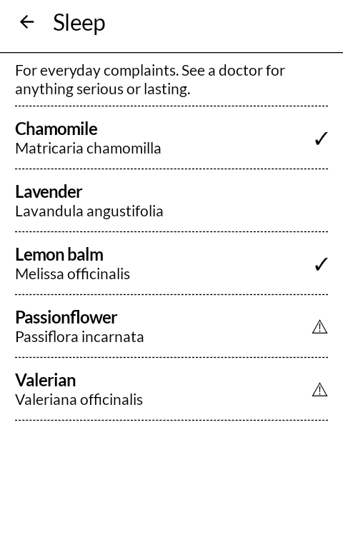
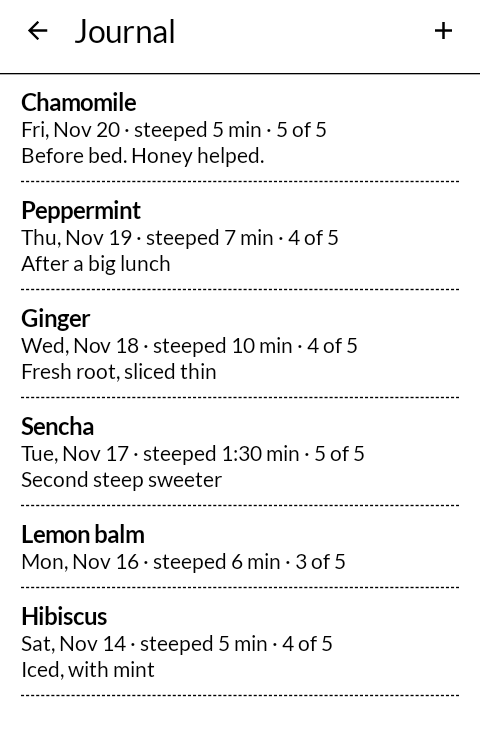

# 薬草 yakusō — Herbal

A small offline book of herbs for tea, for the [Mudita Kompakt](https://mudita.com/products/kompakt/),
built for its E Ink screen.

| | |
|---|---|
|  |  |
|  |  |

Not a fork. Written from scratch in Kotlin and Jetpack Compose, using Mudita's own
[MMD](https://github.com/mudita/MMD) design system so it looks like the apps the phone
already ships with.

*Yakusō* is 薬草: a medicinal herb, a plant gathered for what it does rather than how it looks.

## Not medical advice

**This app is a reference book, not medical advice.** It cannot tell you that an herb is
safe for you. Herbs interact with medicines and can harm some people, in pregnancy and while
nursing especially. If you take any medicine, are pregnant or nursing, or are unwell, ask
your doctor, midwife or pharmacist first, and see a doctor for anything serious or lasting.

The book never says an herb cures or treats anything. It says what an herb is
*traditionally used for*, and then, in one line, what the research says about that.

## What it is

- **Herbs**, A to Z, with a search field. A row carries a ⚠ when the herb has a serious
  caution.
- **An herb's page**, always in the same order: what it is traditionally used for and what the
  research says; how to prepare it (temperatures in °F, then °C); the parts used, the taste
  and other names; its cautions (who should not take it and which medicines it may interact
  with); and its sources. An herb with a serious caution opens with a ⚠ line saying so.
- **"Don't use" pages** for herbs that are not safe to take (comfrey, for one). They open
  with "Don't take this" and the reason, and have no preparation.
- **A finder** by everyday need (sleep, calm, digestion, colds, sore throat, nausea, headache,
  period cramps, pregnancy, nursing), each listing the herbs traditionally used for it. Every
  result says it is for everyday complaints; period cramps, pregnancy and nursing also say to
  ask your midwife or doctor first.
- **A brew timer** with green and black tea, herbal infusion and decoction, and settings of your
  own; an herb's page opens it with that herb's steep. It rings with the screen off.
- **A journal** of what you brewed: the day, how long it steeped, a few words and a rating.
- **A cupboard** of what you have, with the day you bought it and whether it is about to run
  out. An herb's page, and its row in the list, say when it is in your cupboard.

The journal, cupboard and your own timer settings can be kept as one JSON file and read back in.

Dark mode is in Settings, and follows Home's dark switch when Home is installed. The brew
timer's notification uses the phone's notification light. When Cabinet is installed, keeping
and reading a copy open Cabinet's e-ink file screen; without it, the phone's own.

It has no account, no sync and no network: there is no internet permission, and it works in
airplane mode. The only permissions are the brew timer's (an exact alarm, a notification, a
service that plays the ring, and setting a running brew's alarm again after a restart); see
[PRIVACY.md](PRIVACY.md).

## Where the herb text comes from

The cautions and research lines are written from US government pages, which are in the public
domain: the National Center for Complementary and Integrative Health's
[Herbs at a Glance](https://www.nccih.nih.gov/health/herbsataglance), and, where it has no page,
the National Institutes of Health's LiverTox and
LactMed and the US Food and Drug Administration.
Where those are silent, some traditional uses, preparations and two look-alike warnings draw on
English Wikipedia articles (CC BY-SA 4.0), and some pregnancy and nursing notes on four
open-access journal articles (CC BY 3.0 and 4.0). The wording in the app is its own: adapted,
not quoted.

Every herb in `app/src/main/assets/herbs.json` lists its sources, and its page in the app shows
them; a Creative Commons source carries its authors, its license and the article revision or
paper it came from. `tools/check-cautions.py` refuses an herb with no source, no caution, a
Creative Commons source that names no authors, a "don't use" page with a preparation, or the
words "cure" or "treats".

## Status

Early. Every herb was checked line by line against its cited sources before the first release.
An herb added later is marked as a draft until it has been, and its page says so
at the top.

## Building

```sh
python3 tools/check-cautions.py
./gradlew testDebugUnitTest
./gradlew assembleRelease
```

Builds are signed with a keystore in `signing/`, which is gitignored. There is no fallback:
without it the build produces an *unsigned* APK, which will not install anywhere. That is
deliberate: a signing key committed to a public repo is not a signing key, and a missing one
should stop you rather than quietly hand you something installable.

The debug build takes the same key when it is there. The first install of any variant fixes
the signer for good, so a debug build put on a phone is not a throwaway.

## License

The code is GPL-3.0-only. See [LICENSE](LICENSE). The herb text in
`app/src/main/assets/herbs.json` is not all under the GPL: lines adapted from Wikipedia are
CC BY-SA 4.0 and lines adapted from the journal articles CC BY, each credited in the file and on
its herb's page; the US government text is public domain. In the app, About > Licenses shows the source address,
the full license text and everything the app is built with; About also carries Privacy, Terms
and the not-medical-advice note.

Copyright (C) 2026 wander wildwood.
